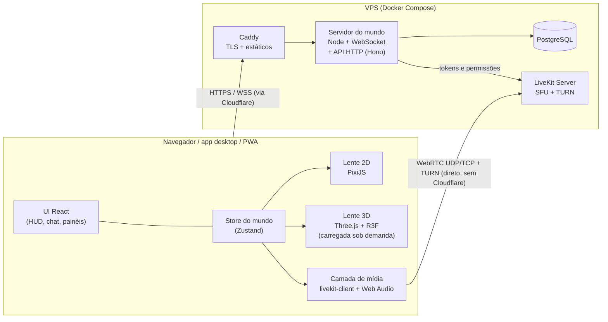

# Infinity Space: arquitetura

Escritório virtual interno da AI Infinity. Um mundo só, visto em 2D ou em 3D. Endereço final: `space.ai-infinity.io`.

Este documento registra as decisões técnicas e o porquê de cada uma. A pesquisa que embasa as escolhas está em [pesquisa/](pesquisa/) (relatório consolidado em `pesquisa/relatorio-consolidado.html`).

## Princípios que decidem dúvidas

1. **Áudio primeiro.** Nada novo entra enquanto áudio, vídeo e tela não estiverem impecáveis.
2. **Um mundo, duas lentes.** Tudo que existe no 3D existe no 2D, no mesmo lugar e com as mesmas regras.
3. **Leve por padrão.** Roda num notebook de 8 GB com GPU integrada. Fica lindo quando o PC aguenta.
4. **Presença, não vigilância.** Mostrar onde as pessoas estão, nunca medir quanto trabalham.
5. **Marca com parcimônia.** Laranja como destaque único; gradiente só em momentos especiais (ver [marca.md](marca.md)).

## Visão geral

## Monorepo

npm workspaces, TypeScript em tudo.

| Pacote | O que é |
|---|---|
| `packages/world` | O mundo como dados e regras puras: formato do mapa, planta do Círculo de Evolução, colisão, rotas, quem ouve quem. Usado pelo servidor e pelas duas lentes. Sem dependência de render. |
| `apps/server` | Servidor do mundo (WebSocket) + API HTTP (login, convites, tokens do LiveKit). |
| `apps/web` | Cliente web: UI, lentes 2D e 3D, mídia. Também é o PWA de celular e tablet. |
| `apps/desktop` | App Electron (etapa posterior): captura de tela com áudio do sistema, atalhos globais, janela flutuante. |

## Decisões

### O mundo (`packages/world`)
- **Unidade: metro.** Coordenadas `x` (leste) e `z` (sul) no plano do chão; `y` é altura, só no 3D. A lente 2D desenha `x,z` vistos de cima.
- **O mapa é dado, não código de render.** Salas, paredes (com portas e vidro), zonas de áudio, móveis, mesas, TVs, pontos de jogo e pontos de nascimento ficam num formato tipado. O 3D extruda paredes e posiciona modelos; o 2D desenha a planta. Mudar o mapa muda os dois.
- **Objetos interativos declaram zona de aproximação e ponto de interação** (padrão da VirtualStation): cadeira, TV, mesa de jogo, porta.
- **Colisão e rotas** numa grade de navegação de 0,25 m gerada do mapa; A* para "clicar e andar".
- **Áudio como regra do mundo.** Uma função pura decide, para cada par de pessoas, se uma ouve a outra e com que ganho, considerando distância, zona, porta, vidro, cadeado, sussurro, megafone e palco. Servidor e cliente rodam a mesma função.

### Servidor do mundo (`apps/server`)
- **Servidor próprio e enxuto:** WebSocket (`ws`) com mensagens binárias (msgpack) e tipos compartilhados no `packages/world`. Avaliamos o Colyseus, mas para 20 pessoas um protocolo próprio de ~300 linhas dá controle total, sem depender da API de uma biblioteca que mudou duas versões grandes recentemente. Uma sala para a empresa toda; jogos e rituais rodam como módulos dentro dela, com ciclo de vida simples (iniciar, entrar, mensagem, tick, sair), inspirado nos scripts do ZEP.
- **HTTP:** Hono no mesmo processo.
- **Movimento:** o cliente move o próprio avatar na hora (sem atraso) e envia posição a ~15 Hz; o servidor valida (velocidade máxima, área andável) e retransmite. Avatares remotos são interpolados a 60 fps. Para uso interno isso dá resposta instantânea sem a complexidade de predição.
- **Privacidade no servidor:** quem pode ouvir quem é decidido no servidor e aplicado no LiveKit (permissões de assinatura por faixa). Um cliente adulterado não consegue ouvir uma sala trancada.
- **API HTTP** no mesmo processo: login, convites, sessão, token do LiveKit.
- **Banco:** PostgreSQL com Drizzle ORM. No desenvolvimento, PGlite (Postgres embutido, sem Docker).
- **Login:** convite por e-mail (Better Auth): link mágico ou senha. Sessão em cookie httpOnly. No desenvolvimento, o link é impresso no terminal.

### Mídia (áudio, vídeo, tela)
- **LiveKit Server open-source** (Apache-2.0), um nó na VPS, com TURN embutido. Usado por 6 dos 7 concorrentes.
- **Assinatura seletiva** (`autoSubscribe: false`): cada cliente só recebe áudio e vídeo de quem pode ouvir ou ver. Mantém CPU e banda baixas.
- **Áudio espacial no cliente:** cada voz passa por Web Audio (ganho + pan estéreo; no 3D, HRTF opcional). Conversas ao redor chegam "abafadas" (passa-baixa + reverb leve), como no Gather.
- **Supressão de ruído escolhida pelo usuário:** DeepFilterNet3 (melhor), RNNoise (leve), filtro do navegador, ou desligada. Tudo open-source, roda no navegador. Mais cancelamento de eco, ganho automático e noise gate.
- **Câmera:** desfoque e fundo virtual com a marca via `@livekit/track-processors` (MediaPipe, roda local).
- **Tela:** publicada sem passar por canvas; `contentHint` por intenção ("documento" = nitidez, "vídeo" = fluidez); várias simultâneas; projetada na TV mais próxima no 3D e como cartão no 2D; tela cheia com um clique. Quando a janela compartilhada é minimizada (faixa muda), quem assiste vê um aviso, não uma imagem quebrada. Áudio do sistema no app desktop.

### Cliente web (`apps/web`)
- **Vite + React 19 + TypeScript.** UI com Tailwind e componentes próprios no padrão shadcn/Radix (acessíveis), animação com Motion. Tokens de cor e tipo vindos da marca.
- **Lente 2D: PixiJS** (WebGL/WebGPU, leve, ótimo no celular). O 2D do Infinity Space é uma planta limpa com avatares, não um tilemap pixel art, então física e tilemap do Phaser não fazem falta; colisão e rotas já vivem no `packages/world`.
- **Lente 3D: Three.js + React Three Fiber + drei**, em chunk separado, baixado só quando a pessoa entra no 3D. Modelos glTF comprimidos (meshopt/Draco, texturas KTX2).
- **Lente contínua:** ao afastar a câmera no 3D, ela sobe até a vista de cima e a cena cruza para a lente 2D, alinhada no mesmo enquadramento. Ao aproximar no 2D, o caminho inverso. A chamada não cai, porque mídia e mundo não dependem da lente.
- **Escada de qualidade automática:** Ultra → Alto → Médio → Leve → 2D → Lista. Mede fps, bateria e calor; desce e sobe avisando. Minimizado ou em Ausente, o mundo para de desenhar e só o áudio continua.
- **Estado:** Zustand. **Idioma:** i18next com textos em `pt-BR`, pronto para outros idiomas.
- **Céu real (`scene/astro`, `scene/sky`):** a estação fica parada a 400 km sobre São Paulo (ficção; o resto é real). Sol, Lua com a fase, planetas, estrelas do catálogo de Yale girando com o tempo sidéreo, eclipses e chuvas de meteoros vêm da astronomy-engine, calculados a cada 5 s no relógio do servidor (meteoros sorteados por minuto: todos veem os mesmos). O céu é desenhado dentro da cena, com uma "câmera do céu" (só a rotação da câmera; no 2D, uma perspectiva virtual) e no fundo do buffer de profundidade: as duas lentes e o telescópio mostram o mesmo céu, e qualquer pós-processamento enxerga tudo. A luz principal vem do Sol real (sombras refeitas só quando ele anda); na sombra da Terra ficam só as luzes internas. Texturas da NASA em `public/space/` (créditos em `CREDITOS.md`).
- **PWA** para celular e tablet, que abrem o 2D por padrão.

### App desktop (`apps/desktop`, etapa posterior)
- **Electron**, porque a captura de tela com áudio do sistema no Windows (loopback) é confiável nele, e a tela foi o maior problema da plataforma antiga. Atalhos globais de mic e câmera, janela flutuante, abrir ao ligar o PC.

### Avatares
- **Criador próprio**, procedural: corpo estilizado montado por partes (rosto, cabelo, roupa, acessórios) com cores livres. Leve e sem custo de assets. O mesmo conjunto de parâmetros desenha o avatar no 3D e o token no 2D. Modelos CC0 (Quaternius, Kenney) podem substituir partes depois.

### Infra (detalhes em [infra.md](infra.md))
- **Docker Compose** na VPS: Caddy, web (estático), servidor do mundo, PostgreSQL, LiveKit.
- **Cloudflare** só no tráfego HTTP do site. O subdomínio de mídia fica como "DNS only" (o proxy não transporta WebRTC).

## Orçamentos de performance

| Item | Meta |
|---|---|
| JS da tela inicial | < 300 KB gzip |
| Lente 2D (chunk) | < 250 KB gzip |
| Lente 3D | baixada só ao entrar no 3D; mundo pronto em < 5 s numa conexão de 50 Mbps |
| FPS | 60 no preset Médio com GPU integrada; nunca abaixo de 30 sem descer de degrau |
| Memória da aba | < 1 GB no 3D, < 400 MB no 2D |
| Minimizado | 0 fps de render, só áudio |

## Ganchos para a V2

O que cada item da V2 vai exigir está em [v2.md](v2.md). A arquitetura já reserva os pontos de encaixe: módulos de sala no servidor (agente de IA, gravação), eventos do mundo (para integrações) e o formato do mapa (para o editor).
